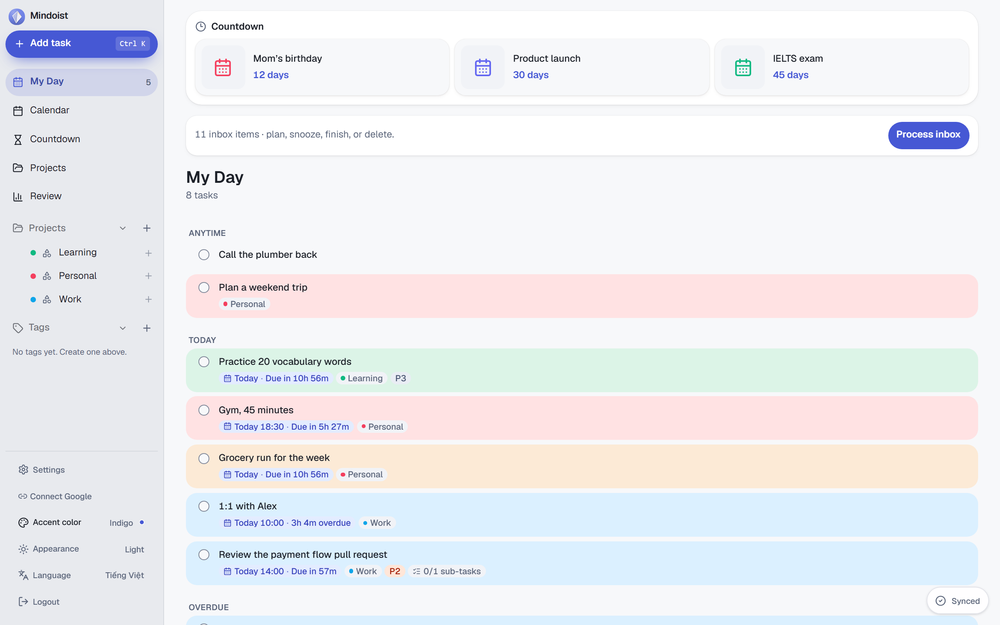
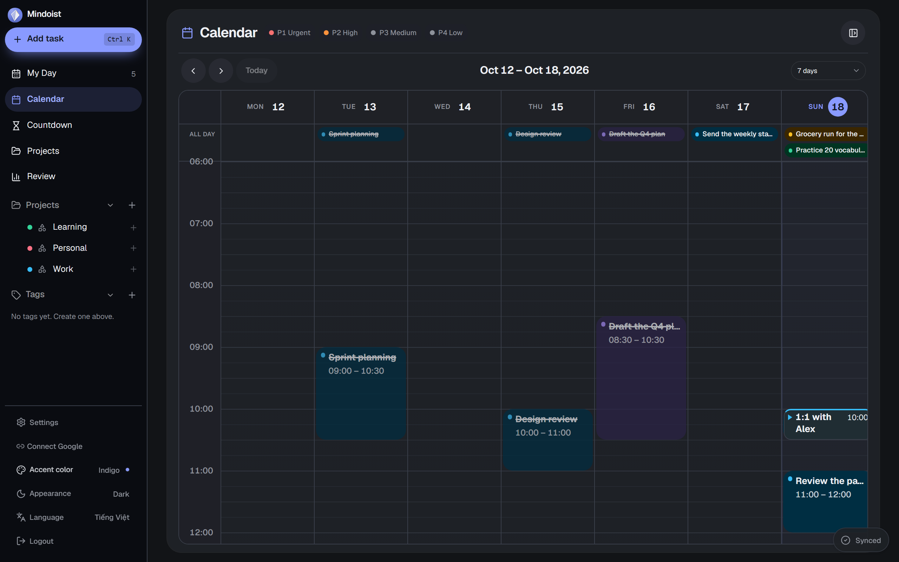
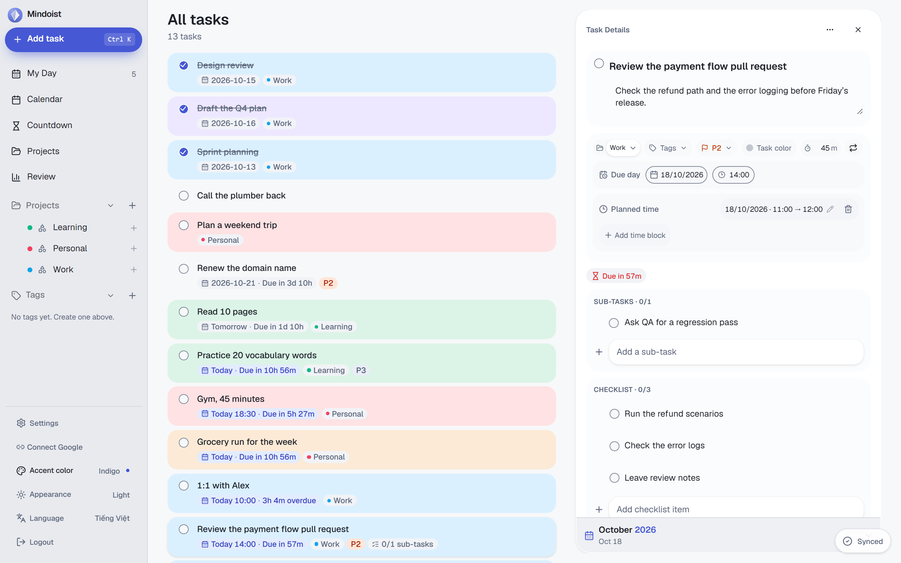
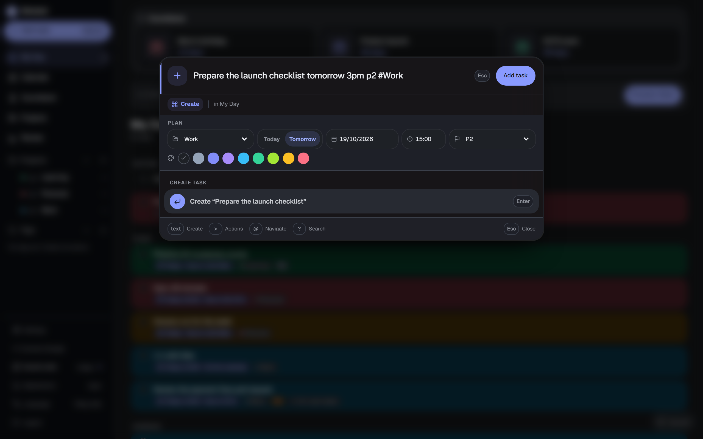

<div align="center">


# Mindoist

**A modern, bilingual task manager with smart lists, a planning calendar, offline support, and Kanban workspaces.**

[](LICENSE)
[](https://www.typescriptlang.org/)
[](https://react.dev/)
[](https://www.fastify.io/)
[](https://www.postgresql.org/)

</div>

---

## Screenshots

<p align="center">
  
  
</p>
<p align="center">
  
  
</p>

<p align="center"><sub>Shown with the HeroUI look, the default on the hosted app. The Classic look is one switch away in Settings.</sub></p>

---

## Features

### Core
- **Task Management** — Priorities (P1–P4), due dates and times, estimates, task colors, tags, descriptions, sub-tasks, and checklists
- **Quick Capture** (`Ctrl/⌘ K`) — Natural-language input in English and Vietnamese (“tomorrow 3pm p2 #Work”) with an editable preview of the date, time, project and priority. The same bar runs actions (`>`), navigation (`@`) and search (`?`)
- **Recurring Tasks** — RFC 5545 RRULE support with automatic next-occurrence generation
- **Smart Lists** — My Day, Upcoming, Overdue, and Completed views
- **Inbox** — Process undated tasks one at a time: plan, snooze, finish, or delete
- **Reminders** — Per-task reminders delivered as web push notifications
- **Countdowns** — Count down to important dates on My Day and in the calendar
- **Notes** and **Global Search** across task titles and descriptions

### Planning & Calendar
- **Week and Month Calendar** — Drag tasks onto the time grid to plan them, drag to reschedule, multi-day ranges
- **Daily Planning** — Plan, Focus and Shutdown steps with a capacity check and “move unfinished to tomorrow”
- **Focus Timer** — Pomodoro timer and due countdown in the task panel
- **Google Calendar Sync** — One-way push (task → event) and read-only pull of existing events
- **Priority Color Coding** — Calendar items colored by priority, with a legend

### Projects & Workspaces
- **Kanban Board and List** — Drag-and-drop tasks across customizable columns
- **Sub-Projects** — Hierarchical project tree with parent/child relationships
- **Project Templates** — Predefined column layouts for Daily Log, Job, Personal, or Custom workflows
- **Task Inspector** — Side panel with inline editing that keeps you in the current view

### Integrations & Data
- **Telegram Bot** — Work with your projects and tasks from Telegram after linking your account
- **Obsidian** — Send a review summary to your vault as a Markdown note, no plugin required
- **Google Drive Backup** — Export tasks, projects and notes to Drive as JSON
- **Import and Export** — TickTick CSV and Mindoist JSON import with a preview; JSON and CSV export

### Offline & PWA
- **Offline-First** — IndexedDB cache via Dexie with automatic background sync
- **Conflict Resolution** — Last-write-wins with cursor-based change tracking
- **Web Push Notifications** — VAPID-based reminders
- **Service Worker** — Workbox-powered caching for installability

### Look & Feel
- **Two UI Kits** — The HeroUI look (default) or Classic, switchable per device in Settings › Appearance or with `?ui-kit=heroui|legacy`
- **Themes** — Light and dark (follows the system), 9 accent color presets, and three densities
- **Bilingual** — Full English and Vietnamese localization with automatic language detection
- **Responsive** — Desktop sidebar, tablet drawer, mobile bottom navigation
- **Accessible** — Keyboard shortcuts, full keyboard use of panels and pickers, reduced-motion support, WCAG AA contrast

### Analytics
- **Review Dashboard** — Completion stats, trend charts, priority breakdowns, and project distribution
- **Review Calendar** — Monthly overview with a day agenda, planned vs. actual time

---

## Tech Stack

| Layer | Technology |
|---|---|
| **Frontend** | React 19, Vite 6, Tailwind CSS v4, HeroUI v3 (React Aria), TanStack Query 5, Framer Motion, cmdk, Dexie 4 |
| **Backend** | Fastify 5, Prisma 6, Zod, pg-boss, jsonwebtoken (self-hosted API) |
| **Edge API** | Supabase Edge Functions (Deno, postgres.js) for the hosted deployment |
| **Database** | PostgreSQL 16 |
| **Shared** | TypeScript 5.8, chrono-node, rrule, design tokens package |
| **Infra** | Docker Compose, pnpm workspaces, Vitest, Playwright, GitHub Actions, Cloudflare Pages |

---

## Getting Started

### Prerequisites

- [Node.js](https://nodejs.org/) 22 (the version CI uses)
- [pnpm](https://pnpm.io/) 10
- [Docker](https://www.docker.com/) (for PostgreSQL)

### Installation

```bash
# Clone the repository
git clone https://github.com/Phieu-Tran/Mindoist.git
cd Mindoist

# Start PostgreSQL
docker compose up -d

# Install dependencies
pnpm install

# Set up environment variables
cp .env.example apps/api/.env
# Edit apps/api/.env — set JWT_SECRET to a secure random string

# Run database migrations
pnpm --filter api prisma migrate deploy

# Seed the database (optional — creates demo user + sample data)
pnpm --filter api prisma db seed
```

### Development

```bash
pnpm dev
```

| Service | URL |
|---|---|
| Web (Vite) | http://localhost:5173 |
| API (Fastify) | http://localhost:3000 |

### Test

```bash
# Unit tests (Vitest)
pnpm test

# Type check
pnpm lint
```

E2E tests use Playwright. Before running them, create and migrate a dedicated
test database (`mindoist_test` by default — see `playwright.config.ts`), then:

```bash
pnpm e2e
```

### Build

```bash
pnpm build
```

### Deploy (Docker)

`docker-compose.prod.yml` runs the API + web + PostgreSQL — the server only needs Docker, no Node/pnpm install.

```bash
# On the server, with the repo checked out:
cp .env.example .env
# Edit .env — set POSTGRES_PASSWORD, JWT_SECRET, DOMAIN (and GOOGLE_CLIENT_ID/SECRET if using Google integration)

docker compose -f docker-compose.prod.yml --env-file .env up -d --build
```

Database migrations run automatically when the `api` container starts. Both services speak plain HTTP: the API on `${API_PORT:-3000}`, the web app (`vite preview` serving the built SPA, no bundled web server) on `${WEB_PORT:-5174}`. Neither terminates TLS itself — point your own reverse proxy (Caddy/Nginx/Cloudflare) at both ports under the same domain, routing API paths (`/auth`, `/tasks`, `/projects`, ... — see `apiRoutes` in `apps/web/vite.config.ts`) to the `api` port and everything else to the `web` port, since the frontend calls the API with relative paths (`VITE_API_URL` unset).

---

## Project Structure

```
mindoist/
├── apps/
│   ├── api/              # Fastify backend + Prisma
│   │   ├── src/          # Routes, middleware, services
│   │   └── prisma/       # Schema, migrations, seed
│   └── web/              # React frontend
│       ├── src/
│       │   ├── components/   # UI components (30+)
│       │   ├── hooks/        # useAuth, useApi, useKeyboardShortcuts
│       │   ├── lib/sync/     # Offline sync engine
│       │   ├── i18n/         # EN + VI locale files
│       │   └── pages/        # Login, Register
│       └── e2e/          # Playwright end-to-end tests
├── packages/
│   ├── shared/           # Shared types, NL parser, recurrence utils
│   └── design-tokens/    # Colors, hues and CSS variables used by the web app
├── supabase/
│   └── functions/        # Edge API (Deno) for the hosted deployment
├── docs/                 # Design docs, plans, test reports
├── docker-compose.yml    # PostgreSQL 16
└── pnpm-workspace.yaml
```

---

## API Endpoints

| Method | Path | Description |
|---|---|---|
| POST | `/auth/register` | Create account |
| POST | `/auth/login` | Sign in (returns JWT) |
| GET | `/auth/me` | Current user |
| CRUD | `/tasks`, `/projects`, `/sections`, `/tags`, `/notes`, `/countdowns`, `/time-blocks` | Resource management |
| GET | `/tasks?filter=today\|upcoming\|overdue` | Smart lists |
| POST | `/tasks/:id/complete`, `/tasks/:id/reopen` | Complete or reopen a task |
| PATCH | `/tasks/:id/move` | Move task to column |
| GET | `/calendar/projection` | Tasks and planned time blocks for a calendar range |
| GET | `/sync/changes` | Pull offline changes |
| POST | `/sync/push` | Push offline mutations |
| GET | `/gcal/auth-url`, `/gcal/events` | Start Google OAuth, read Google Calendar events |
| GET | `/health` | Health check |

---

## Environment Variables

| Variable | Required | Description |
|---|---|---|
| `DATABASE_URL` | Yes | PostgreSQL connection string |
| `JWT_SECRET` | Yes | Secret key for JWT signing |
| `PORT` | No | API server port (default: `3000`) |
| `GOOGLE_CLIENT_ID` | No | Google OAuth client ID |
| `GOOGLE_CLIENT_SECRET` | No | Google OAuth client secret |
| `GOOGLE_REDIRECT_URI` | No | OAuth callback URL (Google Calendar) |
| `GOOGLE_AUTH_REDIRECT_URI` | No | OAuth callback URL (sign-in with Google) |
| `FRONTEND_URL` | No | Where to redirect after OAuth completes (default: `http://localhost:5173`) |

Web build (read by Vite at build time):

| Variable | Required | Description |
|---|---|---|
| `VITE_API_URL` | No | API base URL when the API runs on another origin; leave unset when it shares the web domain |
| `VITE_UI_KIT` | No | Default UI kit for visitors who haven't picked one: `heroui` or `legacy` (Classic, the default when unset) |
| `VITE_UI_KIT_SWITCHER` | No | `off` hides the UI kit switch in Settings |

`docker-compose.prod.yml` only:

| Variable | Required | Description |
|---|---|---|
| `DOMAIN` | Yes | Public domain (no scheme) — used to build the OAuth redirect URLs above |
| `POSTGRES_USER` / `POSTGRES_DB` | No | Defaults: `mindoist_user` / `mindoist_db` |
| `WEB_PORT` | No | Host port for the `web` container (default: `5174`) |

---

## License

This project is licensed under the MIT License — see the [LICENSE](LICENSE) file for details.
